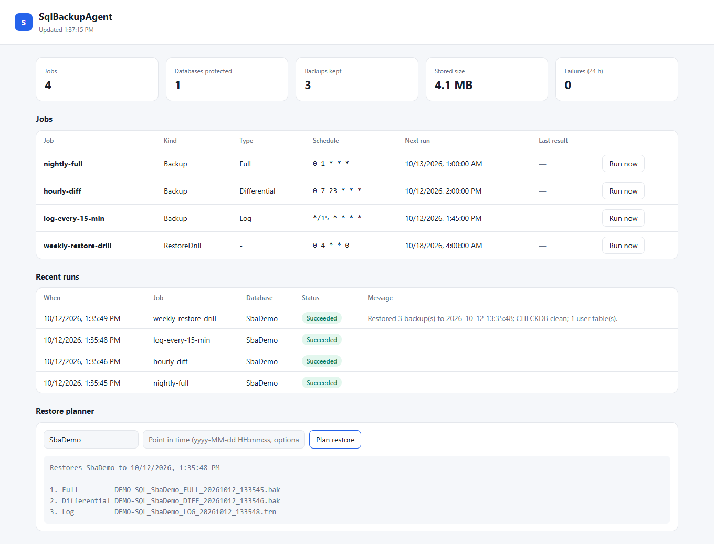
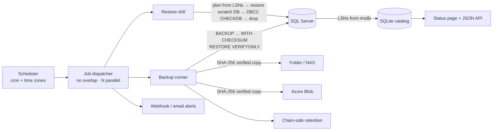

<h1 align="center">SqlBackupAgent: SQL Server backups you can actually restore</h1>

<p align="center">
  A small, open-source backup service for SQL Server. It schedules full / differential / log backups, verifies them,
  copies them off-site (folder, network share or Azure Blob) with checksum verification, applies retention that
  <b>never breaks a restore chain</b>, plans point-in-time restores from LSNs, and runs <b>automatic restore drills</b>
  with <code>DBCC CHECKDB</code> to prove the backups work. Runs as a Windows Service or a Linux systemd unit.
</p>

<p align="center">
  <a href="https://github.com/KumarNitish007/sql-backup-agent/actions/workflows/ci.yml"></a>
  
  
  
  
</p>



## Why

Most backup scripts answer "did the backup run?". The question that matters is **"can I restore to 10:42 this morning?"**.
SqlBackupAgent records every backup's log sequence numbers, so it can always answer that, and it regularly proves it by restoring.

## Features

| | |
|---|---|
| **Scheduled backups** | Full, differential and log jobs on cron schedules (with time zones), wildcard database selection with excludes, `CHECKSUM`, `RESTORE VERIFYONLY`, compression where the edition supports it, optional `COPY_ONLY`. |
| **Sensible automation** | A differential or log backup with no base full is **promoted to a full** automatically; log jobs skip `SIMPLE` recovery databases; Express/LocalDB fall back to uncompressed backups. One failing database never stops the rest. |
| **Off-site copies** | Folder / UNC share and Azure Blob destinations. Every copy is **SHA-256 verified**; folder copies are written to a temp name and renamed atomically. |
| **Chain-safe retention** | Keeps everything needed to restore to *any point* in the last N days: the newest full **before** the window is kept as the anchor, plus a minimum number of fulls. See [docs/decisions.md](docs/decisions.md). |
| **Restore planning** | Picks the newest full, the matching differential (by LSN, not by time) and an unbroken log chain to the requested time. **Gaps are detected** and reported instead of producing a restore that fails halfway. |
| **Restores and drills** | `restore` relocates files (`MOVE`) and fetches missing backups back from a destination. **Restore drills** restore each database into a scratch copy, run `DBCC CHECKDB`, then drop it. |
| **Operations** | Status page and JSON API (jobs, runs, backups, restore-plan preview, manual trigger with optional API key), webhook (Slack/Teams) and email alerts, Windows Service / systemd hosting, SQLite catalog that survives msdb history cleanup. |
| **Containers** | Separate `ServerPath` / `AgentPath` staging settings for SQL Server running in Docker/Kubernetes with a mounted volume. |

## Quick start

```bash
dotnet run --project src/SqlBackupAgent -- validate     # shows exactly which databases each job will touch
dotnet run --project src/SqlBackupAgent -- run nightly-full
dotnet run --project src/SqlBackupAgent                 # service mode: scheduler + status page on http://localhost:5300
```

Edit `src/SqlBackupAgent/appsettings.json` first. A minimal job:

```jsonc
"ConnectionStrings": { "Default": "Server=.;Integrated Security=true;TrustServerCertificate=true" },
"Agent": {
  "Staging":      { "ServerPath": "D:\\SqlBackups\\staging" },          // where SQL Server writes
  "Destinations": { "nas": { "Type": "Folder", "Path": "\\\\nas01\\sql" },
                    "azure": { "Type": "AzureBlob", "Container": "sql-backups", "ConnectionStringName": "BackupStorage" } },
  "Retention":    { "KeepDays": 14, "KeepLastFull": 2 },
  "Jobs": [
    { "Name": "nightly-full", "Type": "Full", "Schedule": "0 1 * * *", "Databases": [ "*" ], "Destinations": [ "nas", "azure" ] },
    { "Name": "logs",         "Type": "Log",  "Schedule": "*/15 * * * *", "Databases": [ "Sales*" ], "Destinations": [ "nas" ] }
  ]
}
```

`Databases` and `Destinations` must be listed explicitly. An empty list is a configuration error, never "everything".
Secrets (connection strings, the storage key, the webhook URL, the SMTP password) belong in environment variables such as
`ConnectionStrings__BackupStorage` or `Agent__Notifications__WebhookUrl`, not in the JSON file.

### Restore

```bash
SqlBackupAgent plan Sales --at "2026-10-12 10:42:00"                 # print the RESTORE script
SqlBackupAgent restore Sales --as Sales_check --at "2026-10-12 10:42:00"
```

```sql
-- Restore Sales as Sales_check to 2026-10-12 10:42:00
-- 3 backup(s): Full, Differential, Log
RESTORE DATABASE [Sales_check] FROM DISK = N'D:\SqlBackups\staging\SRV_Sales_FULL_20261012_010000.bak' WITH NORECOVERY, CHECKSUM, REPLACE, MOVE N'Sales' TO N'D:\Data\Sales_check_Sales.mdf', MOVE N'Sales_log' TO N'D:\Logs\Sales_check_Sales_log.ldf';
RESTORE DATABASE [Sales_check] FROM DISK = N'D:\SqlBackups\staging\SRV_Sales_DIFF_20261012_090000.bak' WITH NORECOVERY, CHECKSUM;
RESTORE LOG [Sales_check] FROM DISK = N'D:\SqlBackups\staging\SRV_Sales_LOG_20261012_104500.trn' WITH NORECOVERY, CHECKSUM, STOPAT = N'2026-10-12T10:42:00.000';
RESTORE DATABASE [Sales_check] WITH RECOVERY;
```

Restoring over the live database is deliberately not a one-liner: `restore` always needs `--as <name>`.

### Install as a service

- **Windows**: `deploy/install-windows-service.ps1` (validates the config, creates the service with restart-on-failure).
- **Linux**: `deploy/sqlbackup-agent.service` (systemd, `Type=notify`, secrets from an environment file).
- Pre-built single-file binaries for both are attached to each GitHub release.

## How it works



## Tests

```bash
dotnet test                                                            # unit tests; SQL tests skip without a server
SQLBACKUP_TEST_SQL="Server=(localdb)\MSSQLLocalDB;Integrated Security=true;TrustServerCertificate=true" dotnet test
```

- **Unit**: restore planning (latest, point in time, diff selection by LSN, copy-only fulls, log gaps, impossible targets),
  chain-safe retention, T-SQL escaping (`QUOTENAME` semantics), database selection, path mapping, cron, catalog LSN precision,
  verified folder copies, and a regression test for configuration binding.
- **SQL Server integration** (LocalDB locally; SQL Server 2022 in a container with a bind-mounted backup folder in CI):
  full → diff → log backups followed by a **real point-in-time restore verified by row counts**, automatic promotion to full,
  `SIMPLE`-recovery skipping, and a restore drill with `DBCC CHECKDB`.
- **Azure Blob** (Azurite in CI): upload, verified download, delete.

## Roadmap

- S3-compatible destination and backup encryption (`ENCRYPTION` with a server certificate)
- Striped backups (multiple files) for very large databases
- Availability Group awareness (back up on the preferred replica)
- Prometheus metrics endpoint

## Author

**Nitish Kumar**, Senior .NET / Full Stack Developer
[Portfolio](https://kumarnitish007.github.io/portfolio-master/) · [LinkedIn](https://linkedin.com/in/nitishkumar043) · [GitHub](https://github.com/KumarNitish007)

More projects: [MiniERP](https://github.com/KumarNitish007/mini-erp-saas) · [OrderFlow](https://github.com/KumarNitish007/orderflow-microservices) · [AskDocs](https://github.com/KumarNitish007/askdocs-rag)
